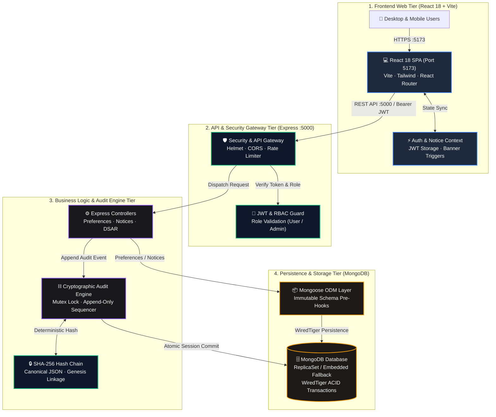

# ConsentLog – Intelligent Consent & Preference Management Platform (Enterprise Edition v2.0)

**ConsentLog** is an enterprise-grade, full-stack privacy and consent governance web application inspired by industry leaders like **OneTrust** and **Metaplane**. It demonstrates how organizations collect, customize, withdraw, and cryptographically audit user consent through a centralized preference management engine connected to a real MongoDB database.

---

## 🌟 Core Enterprise Capabilities

### 1. Interactive Preference Centre
- **5 Granular Categories**:
  1. **Essential Cookies** *(Strictly Necessary — Always Enabled & Protected at API & Schema levels)*
  2. **Analytics Cookies** *(Optional)*
  3. **Marketing Cookies** *(Optional)*
  4. **Personalization** *(Optional)*
  5. **Third-Party Data Sharing** *(Optional)*
- **Interactive Controls**: Individual toggles, **Accept All Optional**, **Reject Optional**, and formal **Right-to-Withdraw Consent**.
- **Live Summary Metrics**: Real-time counters for Total, Enabled, Disabled, and Withdrawn preferences.
- **Confirmation Modal & Notifications**: Displays a cryptographic transaction summary before committing changes, followed by toast notifications.

### 2. Tamper-Evident, Append-Only Consent Audit History (SHA-256 Hash Chain)
- **Zero Mutation Surface**: No `PUT`, `PATCH`, or `DELETE` endpoints exist for `ConsentLog` records. Attempting HTTP mutation returns `403 Forbidden (IMMUTABLE_AUDIT_VIOLATION)`, and Mongoose pre-hooks block `updateOne`, `deleteOne`, and `findOneAndUpdate` at the ODM layer.
- **Canonical SHA-256 Hash Chaining**: Every audit event stores a sequential `sequenceNumber`, `previousHash`, and `eventHash` computed server-side over a deterministic JSON serialization of `{ auditId, sequenceNumber, userId, preferenceName, previousValue, newValue, action, noticeVersion, source, reason, timestamp, previousHash }`.
- **ACID MongoDB Transactions**: Preference updates, `ConsentRecord` snapshots, and `ConsentLog` audit entries are committed atomically using MongoDB sessions/transactions.
- **Live Chain Verification (`POST /api/audit/verify`)**: Recomputes the SHA-256 hash of every historical block from Genesis (`0000...0000`) to Head and reports `Verified` or `Verification Failed`.
- **Threat Model & Production Protections**: Hash chaining reliably detects application-level or single-record tampering, though a privileged DBA with raw disk access could theoretically rewrite the entire chain. In production, pair SHA-256 hash chaining with external RFC 3161/blockchain hash checkpoints, WORM storage (AWS S3 Object Lock), HSM signing, and separated MongoDB role permissions (`insert` + `find` only).

### 3. Version-Controlled Privacy Notices & Side-by-Side Diff Engine
- **Pre-loaded Version Lineage**: Includes **Version 1.0**, **Version 1.1**, and **Version 2.0 (Active)**.
- **Side-by-Side Clause Diff Comparison**: Compare any two versions with visual highlights for **Added (`+`)**, **Modified (`~`)**, and **Removed (`-`)** clauses.
- **Non-Assumed Consent & Renewal Banner**: Publishing or activating a new notice version never assumes automatic user acceptance. Users who have not yet acknowledged the active version see a **Notice Update Banner** prompting them to compare changes and explicitly accept.

---

## 🏛️ System Architecture

ConsentLog employs a defense-in-depth architecture with clear boundaries between the client interface, gateway authentication, transactional privacy controllers, append-only cryptographic auditing, and persistent document storage:



### 🧭 Interactive Archify Viewer & Runtime Features

The architecture is rendered as a fully interactive viewer compiled via **Archify Showcase**:
- **Live Trace Particle Flow**: Directed relationships feature real-time particle animation tracing requests from Browser → API Gateway → Controllers → SHA-256 Chaining → MongoDB.
- **Guided Viewpoints**: One-click preset filters for **Full System Topology**, **Cryptographic Audit Ledger**, and **Authentication & RBAC**.
- **Interactive Node Exploration & Semantic Passport**: Click any component or connection to inspect repository-verified code line ranges, upstream/downstream dependencies, and trust boundaries.
- **Node Finder**: Press `/` in the viewer to search components and boundaries in real-time.
- **In-App Explorer**: Access directly from the running web application via the **Architecture** navigation tab (`/architecture`).
- **Interactive Files**:
  - Standalone Viewer: [architecture/consentlog-platform.html](architecture/consentlog-platform.html) *(or [architecture/index.html](architecture/index.html))*
  - GitHub Pages Deployment: [docs/index.html](docs/index.html) *(deployable via GitHub Pages `/docs` branch setting)*
  - Source Specification: [architecture/candidate.json](architecture/candidate.json)
- **Automated Verification**: Passed 4/4 Archify gates (`validate`, `deliver`, `check`, headless Chrome `browser-check`).

---

## 🛠️ Technology Stack

| Layer | Technologies |
| :--- | :--- |
| **Frontend** | React 18 (Vite), Tailwind CSS (Dark Navy Sidebar + Light/Dark Mode), React Router v7, Axios, Lucide React, Recharts |
| **Backend** | Node.js, Express.js, REST API, MongoDB, Mongoose (with automatic Embedded Replica Set fallback via `mongodb-memory-server`) |
| **Security** | JWT Authentication, `bcryptjs` (12 salt rounds), Zod Input Validation, Role-Based Access Control (`user` / `admin`), `helmet`, `express-rate-limit`, `express-mongo-sanitize`, CORS & Ownership Validation |

---

## 🚀 Installation & Execution Instructions

### 1. Install Dependencies
From the root directory (`c:\ConsentLog`):
```bash
npm run install:all
```

### 2. Run the Full-Stack Application (Backend + Frontend)
```bash
npm run dev
```
- **Frontend UI**: `http://localhost:5173`
- **Backend REST API**: `http://localhost:5000`
- **Database**: Automatically connects to local MongoDB at `mongodb://127.0.0.1:27017/consentlog_enterprise` if running, or seamlessly launches an **Embedded MongoDB Replica Set** with ACID transaction support and auto-seeds sample data.

### 3. Demo Credentials (Pre-Seeded)
| Role | Name | Email | Password |
| :--- | :--- | :--- | :--- |
| **Admin (CPO)** | Elena Vance | `admin@consentlog.io` | `Password123!` |
| **Standard User (GDPR)** | Alex Rivera | `alex@enterprise.io` | `Password123!` |
| **Standard User (DPDP)** | Priya Nair | `priya@cloudscale.in` | `Password123!` |
| **Standard User (CCPA)** | Marcus Sterling | `marcus@pacifichealth.us` | `Password123!` |

*(You can also one-click switch between Standard User and Admin credentials directly on the `/login` page.)*

---

## 🧪 Running the Automated Verification Suite

To run the 14-point automated backend & security test suite:
```bash
npm test
```
This verifies:
1. Unauthenticated request blocking (`401`)
2. User registration with privacy-by-default baseline (`201`)
3. JWT login & `bcrypt` password verification
4. Essential Cookies protection (`400` when attempting to disable)
5. Transactional preference updates & audit log creation
6. Formal consent withdrawal & historical preservation
7. Append-only HTTP immutability (`403` on `PUT`, `PATCH`, `DELETE /api/audit/logs/:id`)
8. Mongoose ODM-level immutability hook enforcement
9. Cross-user ownership validation (`403` when inspecting another user's private audit log)
10. Full SHA-256 cryptographic hash chain verification (`POST /api/audit/verify`)
11. Role-Based Access Control (`403` for non-admins on `/api/admin/*`)
12. Privacy Notice side-by-side clause diff comparison (`v1.0` vs `v2.0`)
13. Admin notice publication & non-assumed user acceptance
14. Explicit user notice acknowledgment & audit linkage

