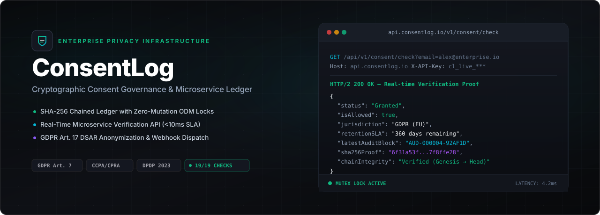
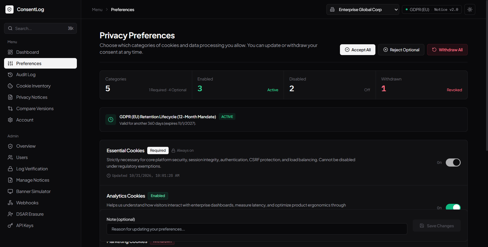
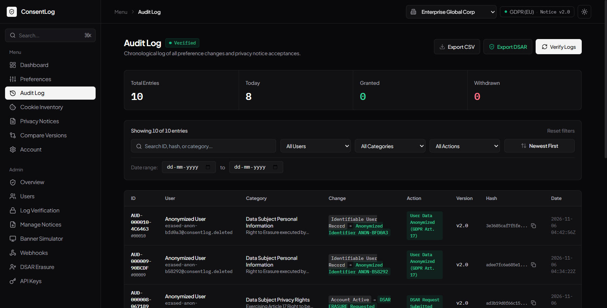
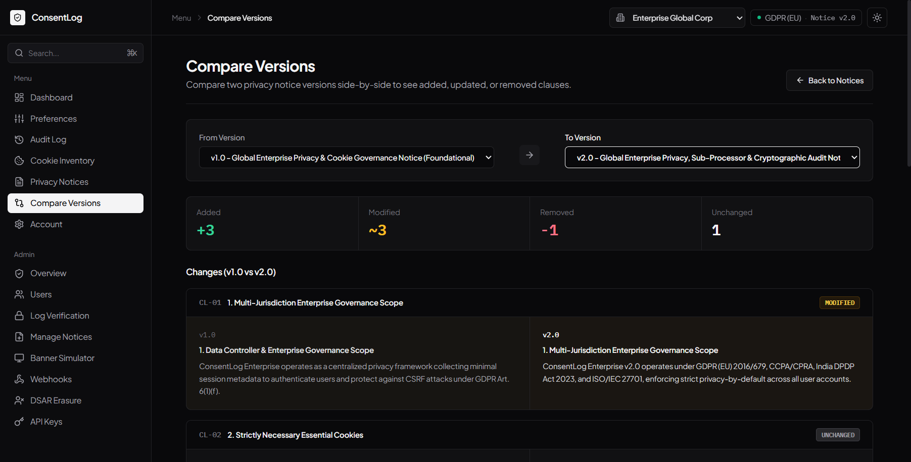
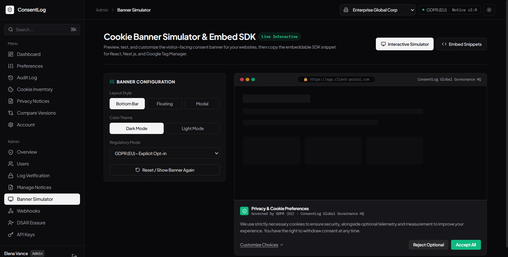
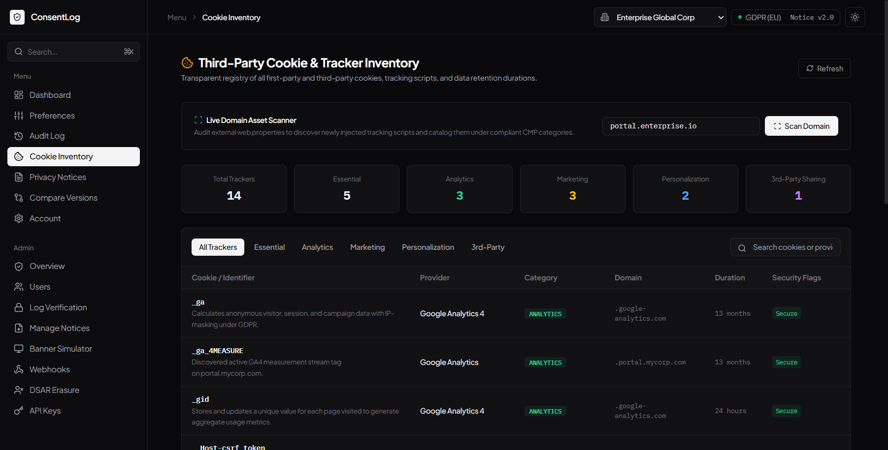

<div align="center">



<br/>

[](https://github.com/Git-huber2007/consentlog)
[](https://gdpr-info.eu/)
[](https://github.com/Git-huber2007/consentlog)
[](https://nodejs.org/)

<br/><br/>

[Overview](#-executive-overview) • [Visual Showcase](#-visual-showcase) • [Key Capabilities](#-enterprise-capabilities) • [Architecture](#-system-architecture) • [Microservice API](#-real-time-verification-api) • [Quick Start](#-quick-start) • [Compliance Matrix](#-regulatory-compliance-matrix)

</div>

---

## 📋 Executive Overview

Modern privacy regulations (**GDPR Art. 7**, **CCPA/CPRA § 1798.120**, **DPDP Act 2023 Sec. 6**) require organizations to maintain undeniable, itemized proof of consumer consent. 

**ConsentLog** replaces black-box cookie banners with a full-lifecycle privacy infrastructure:
- **Zero-Mutation Cryptographic Ledger**: Every consent change is written to an append-only SHA-256 hash-chained block. Audit records cannot be altered or deleted at the API or database layer.
- **Microsecond Microservice Intercepts**: Backend services, email queues, and tracking pixels verify user consent in real time (`<10ms`) via authenticated REST endpoints.
- **Privacy-by-Default Architecture**: All non-essential categories (Marketing, Analytics, Third-Party Sharing) remain strictly disabled until explicit opt-in.
- **Enterprise DSAR & Erasure Automation**: Fulfills GDPR Article 17 "Right to Erasure" by cryptographically anonymizing identifying user data while preserving ledger chain continuity.

---

## 📸 Visual Showcase

### 1. Interactive Preference Centre & Legal Retention SLA
Granular controls across 5 categories, protected Essential Cookies enforcement, one-click Right to Withdraw, and real-time EDPB/CNIL legal retention countdown timer.

<p align="center">
  
</p>

---

### 2. Tamper-Evident SHA-256 Chained Audit History
Append-only cryptographic ledger tracking block sequence IDs, previous block hashes, deterministic SHA-256 verification seals, and one-click GDPR Art. 15/20 data passport export.

<p align="center">
  
</p>

---

### 3. Privacy Notice Versioning & Side-by-Side Diff Engine
Auditable policy lifecycle management with automated visual clause diffing (`+` additions in green, `~` modifications in amber, `-` removals in red) and non-assumed re-consent enforcement.

<p align="center">
  
</p>

---

### 4. Visitor Cookie Banner Simulator & GTM Consent Mode v2
Real-time banner customization with Bottom Bar, Floating Shield, and Modal Dialog layouts, dark/light themes, and drop-in Google Tag Manager Consent Mode v2 integration code.

<p align="center">
  
</p>

---

### 5. Live Cookie & Tracker Inventory Scanner
Comprehensive domain crawler classifying first- and third-party trackers (Google Analytics, Hotjar, Stripe, Segment) across regulatory classifications with direct preference mapping.

<p align="center">
  
</p>

---

## ⚡ Enterprise Capabilities

<table>
<tr>
<td width="50%" valign="top">

### 🔒 Cryptographic Audit Ledger
- **Append-Only Immutability**: All HTTP `PUT`, `PATCH`, and `DELETE` requests against audit records are hard-blocked with `403 Forbidden` (`IMMUTABLE_AUDIT_VIOLATION`).
- **Deterministic SHA-256 Chaining**: Each block hash is cryptographically computed from canonical payload, sequence index, and previous block hash.
- **Live Head-to-Genesis Verifier**: Automated recomputation endpoint (`POST /api/audit/verify`) detects even 1-bit discrepancies.
- **Data Portability Passport**: Exports GDPR Art. 15/20 cryptographically signed JSON & PDF passports.

</td>
<td width="50%" valign="top">

### ⏱️ Retention & Expiration Lifecycle
- **EDPB & CNIL SLA Calculations**: Automatically calculates dynamic consent decay per legal jurisdiction (12 months for GDPR, 6 months for CNIL, 24 months for CCPA).
- **Proactive Renewal Countdown**: Informs users and data protection officers before consent expires.
- **Auto-Revocation Enforcement**: System automatically flags expired preferences to halt unconsented processing.

</td>
</tr>
<tr>
<td width="50%" valign="top">

### 🔀 Downstream Webhook Dispatcher
- **Decoupled Event Broadcasting**: Propagates consent transitions (`granted`, `withdrawn`, `updated`, `erased`) to external CRMs, CDPs, and data warehouses in real time.
- **HMAC-SHA256 Delivery Signatures**: Dispatches `X-ConsentLog-Signature: sha256=<hmac>` headers generated with endpoint-specific secrets.
- **Delivery Audit Logs**: Tracks status codes, payload hashes, and round-trip delivery latencies.

</td>
<td width="50%" valign="top">

### 👤 Article 17 DSAR Erasure Engine
- **Legal Compliance Without Ledger Destruction**: Reconciles the legal tension between GDPR erasure mandates and accounting/security non-repudiation.
- **Cryptographic Pseudonymization**: Sanitizes identifying PII into irreversible tokens (`ANON-XXXXXX`, `erased-XXXX@consentlog.deleted`).
- **Terminal Block Creation**: Documents the erasure event on the immutable ledger without modifying past blocks.

</td>
</tr>
<tr>
<td width="50%" valign="top">

### 🔍 Cookie & Tracker Inventory Scanner
- **Categorized Tracker Registry**: Live catalog mapping trackers across Essential, Analytics, Marketing, and Functional groups.
- **Autonomous Domain Scanner**: Crawls web domains to detect first-party cookies, tracking beacons, and third-party script sources.
- **Direct Policy Enforcement**: Syncs discovered trackers directly with user preference categories and GTM consent variables.

</td>
<td width="50%" valign="top">

### 🎛️ Versioned Notices & Banner Simulator
- **Notice Lineage & Side-by-Side Diffs**: Visual clause comparison highlighting additions (`+`), modifications (`~`), and deletions (`-`).
- **Non-Assumed Consent Gate**: Notice updates automatically trigger explicit review prompts rather than implied consent.
- **Consent Mode v2 Simulator**: Interactive preview across Bottom Bar, Floating Shield, and Modal styles with drop-in GTM code snippets.

</td>
</tr>
</table>

---

## 🏛️ System Architecture

[](docs/index.html)

<div align="center">
  <sub>Click the architectural diagram above to launch the interactive viewer with pan, zoom, search, and subsystem inspection.</sub>
</div>

<br/>

- **🚀 Interactive Viewer**: [Open Full-Screen Canvas](docs/index.html) *(Pan, zoom, and inspect every tier)*
- **📐 Archify Specification**: [`architecture/candidate.json`](architecture/candidate.json) *(Typed component & boundary model)*
- **🌐 Standalone Canvas**: [`docs/index.html`](docs/index.html) *(Open locally or deploy via GitHub Pages)*

<details open>
<summary><b>🔍 Architectural Tiers & Component Topology</b></summary>
<br/>

| Tier | Component | Responsibilities & Protocols |
| :--- | :--- | :--- |
| **1. Frontend Web Tier** | Browser Client | Desktop & mobile clients communicating via HTTP/2 TLS |
| | React 18 SPA | Vite 6 build, Tailwind CSS design system, React Router v7 navigation |
| | Client State | AuthContext JWT token cache, ToastProvider notifications, Notice renewal checks |
| **2. Security & Gateway** | API Gateway | Express v4 reverse proxy on `:5000` with Helmet security headers & CORS origin isolation |
| | Security Guards | JWT authentication, bcryptjs password hashing, Express Rate Limiter (500 req/15m) |
| | Input Sanitization | Mongo-sanitize for NoSQL injection prevention, Zod strict boundary schema validation |
| **3. Business Logic & Ledger** | Controllers | Preference manager, notice side-by-side diff engine, DSAR compliance export |
| | Sequencer Service | Mutex-locked append-only queue enforcing non-blocking sequential block creation |
| | Hash Chain Service | Deterministic SHA-256 hash chaining (`eventHash = SHA256(canonicalPayload + prevHash)`) |
| | Webhook Service | Asynchronous HMAC-SHA256 event broadcast to external endpoints |
| **4. Persistence & Storage** | Mongoose ODM | Schema enforcement, document models (`User`, `Preference`, `ConsentLog`, `PrivacyNotice`) |
| | Hook Guard | Pre-save and pre-remove hooks blocking `updateOne`, `deleteOne`, and `findOneAndUpdate` |
| | MongoDB Engine | WiredTiger storage engine with ACID multi-document transactions and replica set support |

</details>

<br/>

```
                    ┌────────────────────────────────────────────────────────┐
                    │               CLIENTS & INTEGRATIONS                  │
                    │   React 18 SPA  ·  Mobile Apps  ·  External Services   │
                    └───────────────────────────┬────────────────────────────┘
                                                │ HTTPS / REST / Webhooks
                                                ▼
                    ┌────────────────────────────────────────────────────────┐
                    │                 SECURITY GATEWAY TIER                  │
                    │   Helmet · Rate Limiter · JWT Auth · Microservice Keys │
                    │   Express Mongo Sanitize · Role-Based Access Control   │
                    └───────────────────────────┬────────────────────────────┘
                                                │
                 ┌──────────────────────────────┴──────────────────────────────┐
                 ▼                                                             ▼
  ┌───────────────────────────────┐                             ┌───────────────────────────────┐
  │      GOVERNANCE ENGINE        │                             │    DISPATCH & AUDIT TIER      │
  │  · 5 Granular Categories      │                             │  · SHA-256 Hash Chained Logs  │
  │  · EDPB/CNIL Retention SLA    │                             │  · Mutex Sequencer Service    │
  │  · Versioned Notices & Diffs  │                             │  · HMAC-SHA256 Signed Hooks   │
  │  · Article 17 DSAR Erasure    │                             │  · Cryptographic Certificates │
  │  · Tracker Inventory Scanner  │                             │  · Microservice Status Engine │
  └──────────────┬────────────────┘                             └──────────────┬────────────────┘
                 │                                                             │
                 └──────────────────────────────┬──────────────────────────────┘
                                                │
                                                ▼
                    ┌────────────────────────────────────────────────────────┐
                    │                DATA PERSISTENCE LAYER                  │
                    │  MongoDB WiredTiger Engine · Embedded ReplSet Fallback │
                    │  Mongoose ODM Mutation Locks (Block PUT/PATCH/DELETE)  │
                    └────────────────────────────────────────────────────────┘
```

---

## ⚡ Real-Time Verification API

Microservices, marketing automation engines, and analytics pipelines query this endpoint prior to processing personal data.

### Request

```bash
curl -X GET "https://api.consentlog.io/api/v1/consent/check?email=alex@enterprise.io&category=marketing" \
  -H "X-API-Key: cl_live_084a7a9094054a329beacbcf92da6839"
```

### Response (`200 OK`)

```json
{
  "success": true,
  "dataSubject": {
    "id": "6aed581ed4a6fde9f4a62791",
    "email": "alex@enterprise.io",
    "jurisdiction": "GDPR (EU)",
    "organization": "Enterprise Global Corp"
  },
  "category": "marketing",
  "isAllowed": true,
  "status": "Granted",
  "noticeVersion": "2.0",
  "lastConsentUpdate": "2026-11-06T04:31:28.442Z",
  "latestAuditId": "AUD-000004-92AF1D",
  "latestAuditHash": "6f31a53f81c21390147a9a9f64bbb14190b5a2601177ec9bdddb1d27f78ffe28",
  "cryptographicProof": "SHA-256 Ledger Verified",
  "timestamp": "2026-11-06T10:45:00.000Z"
}
```

<details>
<summary><b>🔍 Expand Full REST API Route Reference</b></summary>
<br/>

| Scope | Method | Route | Description | Auth Required |
| :--- | :--- | :--- | :--- | :--- |
| **Microservice** | `GET` | `/api/v1/consent/check` | Real-time status lookup with SHA-256 proof block | `X-API-Key` |
| **Preferences** | `GET` | `/api/preferences` | Retrieve user preferences across all 5 categories | User JWT |
| | `PUT` | `/api/preferences` | Batch update preferences with transactional audit logging | User JWT |
| | `PATCH` | `/api/preferences/:name` | Toggle individual preference | User JWT |
| **Consent** | `POST` | `/api/consent/withdraw` | Execute formal Right to Withdraw consent | User JWT |
| | `GET` | `/api/consent/retention` | Get consent expiration countdown & legal SLA | User JWT |
| | `POST` | `/api/consent/dsar/request` | Submit GDPR Article 17 Right to Erasure request | User JWT |
| | `GET` | `/api/consent/dsar/my-requests` | View user's submitted DSAR requests | User JWT |
| **Audit Ledger** | `GET` | `/api/audit` | Paginated SHA-256 chained audit logs | User JWT |
| | `POST` | `/api/audit/verify` | Recompute cryptographic chain from Genesis to Head | User / Admin |
| | `GET` | `/api/audit/certificate` | Export cryptographic audit certificate receipt | User / Admin |
| | `GET` | `/api/audit/dsar-passport` | Export GDPR Art. 15/20 cryptographically signed passport | User JWT |
| **Notices** | `GET` | `/api/notices/active` | Fetch active privacy notice with localized content | Public |
| | `GET` | `/api/notices/:version` | Fetch historical notice with diff comparison (`?compareWith=`) | Public |
| | `POST` | `/api/notices/acknowledge` | Acknowledge notice and append audit block | User JWT |
| **Admin** | `GET` | `/api/admin/metrics` | System-wide consent distribution telemetry | Admin JWT |
| | `GET` | `/api/admin/webhooks` | List registered downstream webhook endpoints | Admin JWT |
| | `POST` | `/api/admin/webhooks` | Register webhook with HMAC-SHA256 secret | Admin JWT |
| | `POST` | `/api/admin/webhooks/:id/test` | Dispatch test ping to webhook endpoint | Admin JWT |
| | `GET` | `/api/admin/dsar/requests` | List pending Article 17 erasure requests | Admin JWT |
| | `POST` | `/api/admin/dsar/requests/:id/process` | Execute cryptographic pseudonymization & log block | Admin JWT |
| | `GET` | `/api/admin/cookies` | List cookie & tracker inventory | Admin JWT |
| | `POST` | `/api/admin/cookies/scan` | Trigger live domain tracker scan | Admin JWT |
| | `GET` | `/api/admin/api-keys` | List active microservice API keys | Admin JWT |
| | `POST` | `/api/admin/api-keys` | Generate new API key (`cl_live_...`) | Admin JWT |
| | `DELETE` | `/api/admin/api-keys/:id` | Revoke microservice API key | Admin JWT |

</details>

---

## 🚀 Quick Start

### 1. Installation

```bash
git clone https://github.com/Git-huber2007/consentlog.git
cd consentlog
npm run install:all
```

### 2. Run Development Cluster

```bash
npm run dev
```

- **Frontend Client**: `http://localhost:5173`
- **Backend Gateway**: `http://localhost:5000`
- **Health Telemetry**: `http://localhost:5000/api/health`

*(If MongoDB is not running locally, ConsentLog automatically initializes an embedded multi-document replica set with full ACID transaction support).*

### 3. Production Build

```bash
npm run build
```

---

## 🧪 Verification & Security Suite

ConsentLog includes a 19-point automated integration and security test suite validating zero-mutation constraints, cryptographic chaining, and regulatory workflows.

```bash
npm test
```

```
======================================================================
  CONSENTLOG ENTERPRISE - VERIFICATION RESULTS (19/19 CHECKS)
======================================================================
  [1/19]  Unauthorized API requests strictly blocked (HTTP 401)             ✅ PASSED
  [2/19]  User registration & privacy-by-default onboarding verified        ✅ PASSED
  [3/19]  JWT Authentication & bcrypt password verification passed          ✅ PASSED
  [4/19]  Essential Cookies protection enforced (cannot be disabled)        ✅ PASSED
  [5/19]  Preference updates & transactional ConsentLog creation verified   ✅ PASSED
  [6/19]  Consent withdrawal & historical audit preservation verified       ✅ PASSED
  [7/19]  Append-only API immutability enforced (PUT/PATCH/DELETE blocked)  ✅ PASSED
  [8/19]  Mongoose ODM-level immutability hooks verified                    ✅ PASSED
  [9/19]  Ownership validation enforced (cross-user isolation)              ✅ PASSED
  [10/19] SHA-256 Hash Chain verified across all blocks                     ✅ PASSED
  [11/19] Role-Based Access Control verified (Admin routes protected)       ✅ PASSED
  [12/19] Privacy Notice side-by-side diff engine verified                  ✅ PASSED
  [13/19] Versioned Privacy Notice publication & non-assumed consent        ✅ PASSED
  [14/19] Explicit Privacy Notice acceptance & SHA-256 audit linkage        ✅ PASSED
  [15/19] Consent Retention SLA calculated (EDPB / CNIL countdown)          ✅ PASSED
  [16/19] Webhook created with HMAC-SHA256 secret and event listeners       ✅ PASSED
  [17/19] Article 17 Right to Erasure executed and user anonymized          ✅ PASSED
  [18/19] Domain scanner cataloged cookies across 5 regulatory categories   ✅ PASSED
  [19/19] External API query verified consent status with SHA-256 proof     ✅ PASSED
======================================================================
  ALL 19/19 VERIFICATION CHECKS PASSED (100% SUITE INTEGRITY)
======================================================================
```

---

## 👥 Demo Credentials

| Identity | Email | Password | Primary Jurisdiction |
| :--- | :--- | :--- | :--- |
| **Chief Privacy Officer (Admin)** | `admin@consentlog.io` | `Password123!` | Global Governance HQ |
| **Enterprise User (GDPR)** | `alex@enterprise.io` | `Password123!` | GDPR (European Union) |
| **Healthcare User (DPDP)** | `priya@enterprise.io` | `Password123!` | DPDP Act (India) |
| **Financial User (CCPA)** | `marcus@enterprise.io` | `Password123!` | CCPA / CPRA (California) |

*(One-click demo switching buttons are available directly on the login page).*

---

## 🛡️ Regulatory Compliance Matrix

| Legal Mandate | Regulatory Requirement | ConsentLog Architectural Enforcement |
| :--- | :--- | :--- |
| **GDPR Art. 7(1)** | Burden of Proof | Deterministic SHA-256 chained audit trail providing mathematically verifiable proof of consent at any millisecond. |
| **GDPR Art. 7(3)** | Right to Withdraw | One-click withdrawal mechanism matching the ease of granting consent; immediately revokes downstream processing tokens. |
| **GDPR Art. 15 & 20** | Access & Portability | Cryptographically sealed JSON and PDF DSAR compliance passports containing complete historical consent lineages. |
| **GDPR Art. 17** | Right to Erasure | Cryptographic anonymization to `ANON-XXXXXX` ensuring PII destruction while preserving immutable ledger continuity. |
| **EDPB Guidelines 05/2020** | Expiration & Refresh | SLA countdown engine computing legal expiration windows and prompting explicit renewal before consent decay. |
| **CCPA / CPRA § 1798.120** | Opt-Out of Sale / Sharing | Dedicated third-party data sharing controls backed by immediate HMAC-SHA256 signed webhook dispatch to downstream data brokers. |
| **DPDP Act 2023 Sec. 6** | Itemized Notice & Consent | Notice version lineage with clause-level diffing and mandatory re-affirmation gates prior to processing. |
| **ISO/IEC 27001:2022 (A.8.15)** | Non-Repudiation Logging | Write-once append-only database guards and ODM mutation hooks eliminating unauthorized tampering or deletion. |
